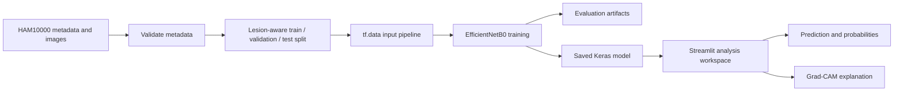
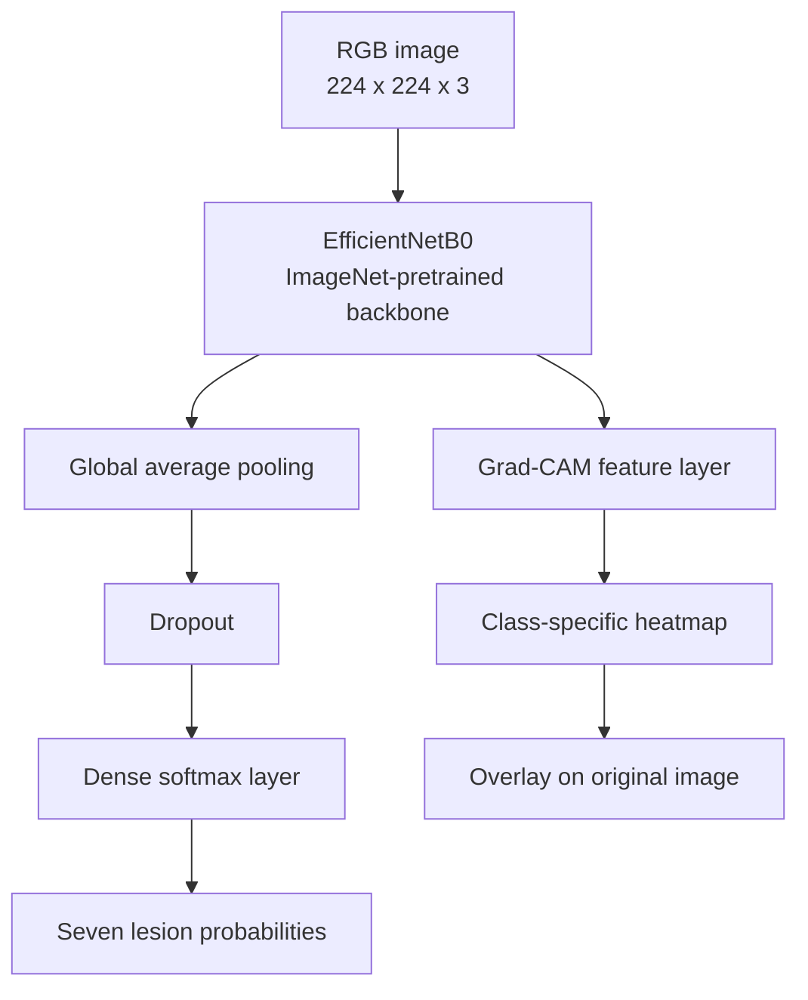
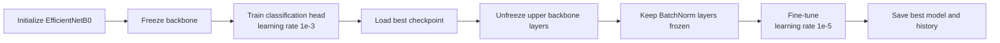
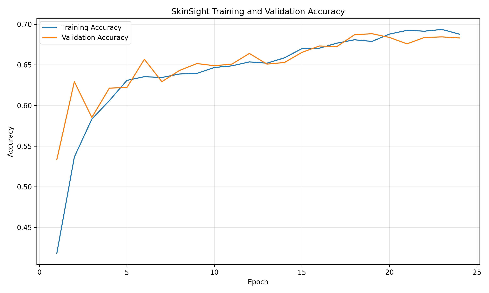
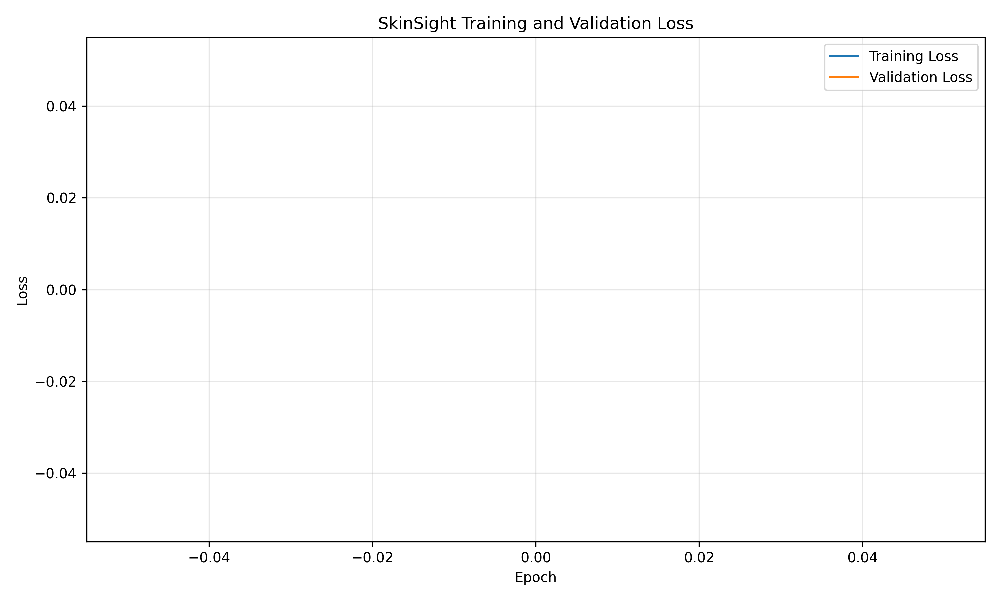
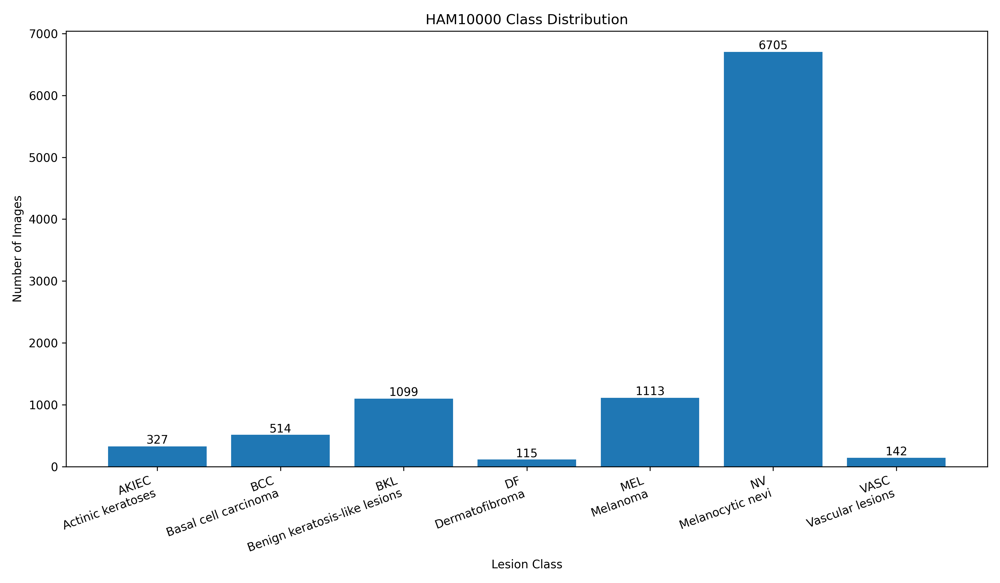
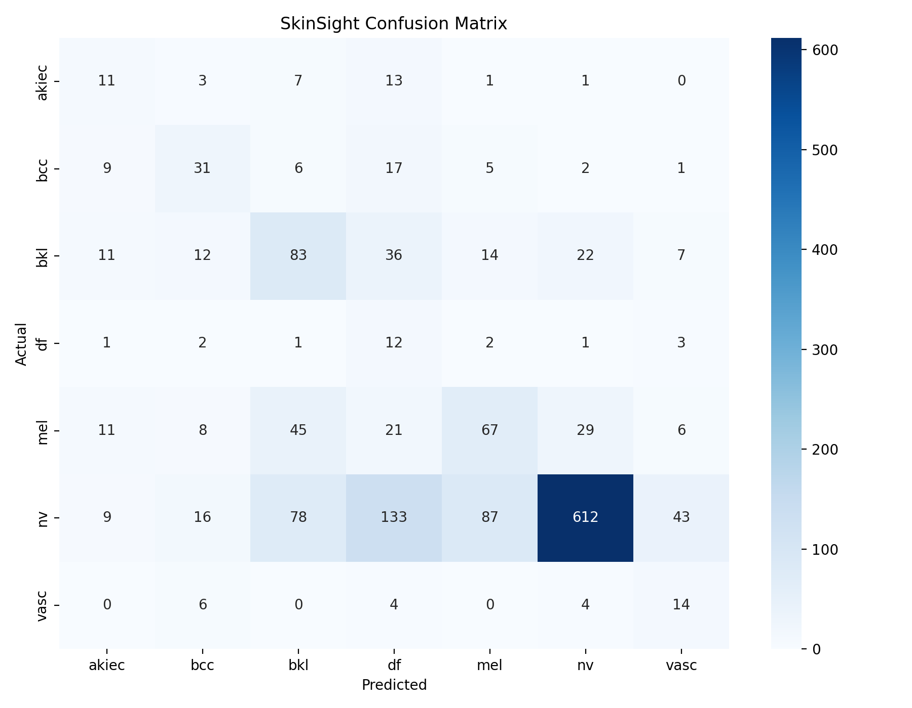
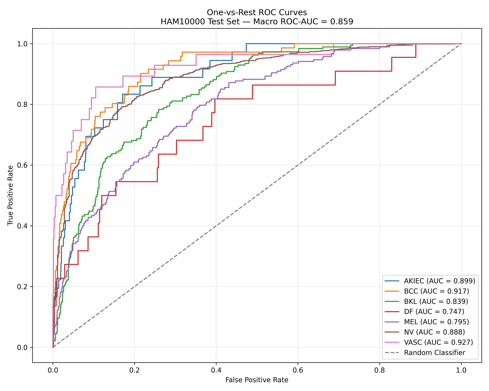

# SkinSight

Explainable skin-lesion classification with EfficientNetB0, Grad-CAM, and a Streamlit research workspace.

SkinSight is an academic and educational prototype built around the HAM10000 dermatoscopic image dataset. It predicts one of seven lesion classes, exposes the full probability distribution, and produces a Grad-CAM visualization of image regions that influenced the model output.

> **Medical disclaimer:** SkinSight is not a medical diagnostic system. Its predictions and visual explanations may be incorrect and must not be used for diagnosis, treatment, triage, or clinical decision-making.

## Highlights

- Seven-class dermatoscopic image classification
- EfficientNetB0 transfer learning with fine-tuning
- Class weighting for imbalanced training data
- Lesion-aware train, validation, and test splits
- Accuracy, loss, ROC, confusion-matrix, and class-distribution visualizations
- Grad-CAM explainability for individual predictions
- Streamlit workspace with analysis, evaluation, dataset, and research pages
- Light and dark themes through Streamlit's native theme system
- Downloadable JSON analysis reports

## Supported classes

| Code | Class |
| --- | --- |
| `akiec` | Actinic keratoses / intraepithelial carcinoma |
| `bcc` | Basal cell carcinoma |
| `bkl` | Benign keratosis-like lesions |
| `df` | Dermatofibroma |
| `mel` | Melanoma |
| `nv` | Melanocytic nevi |
| `vasc` | Vascular lesions |

The model's class order is stored in [`models/class_names.json`](models/class_names.json).

## Current evaluation snapshot

These values describe the current saved evaluation artifacts. Retraining can produce different results.

| Metric | Value |
| --- | ---: |
| Test accuracy | 67.55% |
| Macro F1 | 50.92% |
| Weighted F1 | 70.29% |
| Macro ROC-AUC | 90.18% |

Accuracy and weighted F1 are influenced by class distribution. Macro F1 gives every class equal weight. ROC-AUC measures ranking quality and should not be interpreted as clinical reliability.

## Architecture

### End-to-end workflow



### Model architecture



### Two-stage training



The first stage adapts the classification head. The second stage makes a smaller update to the upper EfficientNet layers while keeping BatchNormalization layers stable.

## Project structure

```text
SkinSight/
├── app/
│   ├── streamlit_app.py                 # Navigation entrypoint
│   ├── app.py                            # Analyze page and Grad-CAM workflow
│   └── app_pages/
│       ├── about.py                      # Research notes and limitations
│       ├── dataset_explorer.py           # HAM10000 metadata views
│       └── model_performance.py          # Training and evaluation gallery
├── data/
│   ├── raw/                              # Local HAM10000 files
│   ├── processed/                        # Generated processed data
│   └── splits/                           # Generated split CSV files
├── docs/                                 # Project documentation
├── models/                               # Model metadata and local artifacts
├── outputs/                              # Figures and Grad-CAM images
├── src/                                  # Preparation, training, evaluation, inference
├── .streamlit/config.toml                # Light and dark theme tokens
├── mise.toml                             # Python 3.10 declaration
├── requirements.txt
└── README.md
```

## Requirements

- Python 3.10.x
- Git
- A local HAM10000 dataset copy
- Enough disk space for TensorFlow, the dataset, and generated model artifacts

Python 3.10 is intentional. The TensorFlow range in `requirements.txt` is compatible with Python 3.10, while newer Python versions may not have matching TensorFlow wheels.

## Quick start

### Using mise

The repository includes [`mise.toml`](mise.toml) with Python 3.10 configured.

```bash
mise install
mise exec -- python -m venv .venv
source .venv/bin/activate
python -m pip install -r requirements.txt
```

On Windows PowerShell:

```powershell
mise install
mise exec -- python -m venv .venv
.\.venv\Scripts\Activate.ps1
python -m pip install -r requirements.txt
```

Verify the active interpreter before installing:

```bash
python --version
python -c "import sys; print(sys.executable)"
```

The version should be Python 3.10.x and the executable should be inside `.venv` after activation.

### Without mise

```bash
python3.10 -m venv .venv
source .venv/bin/activate
python -m pip install -r requirements.txt
```

## Dataset setup

HAM10000 is not bundled with this repository. Download it from an authorized source and place it here:

```text
data/raw/
├── HAM10000_metadata.csv
└── images/
    ├── ISIC_0024306.jpg
    ├── ISIC_0024307.jpg
    └── ...
```

The metadata file must include at least `image_id` and `dx`, where `dx` contains the lesion class code.

Prepare the dataset and generate split files:

```bash
python src/data_preparation.py
```

Expected output:

```text
data/splits/train.csv
data/splits/val.csv
data/splits/test.csv
```

## Train and evaluate

Train the two-stage EfficientNetB0 pipeline:

```bash
python src/train.py
```

The pipeline loads the data, applies preprocessing and augmentation, calculates class weights, trains the classification head, fine-tunes the upper backbone layers, and exports the best model and history.

Generate evaluation and training figures:

```bash
python src/evaluate.py
python src/visualize_training.py
python src/visualize_dataset.py
python src/visualize_roc.py
```

Outputs are written to [`outputs/figures/`](outputs/figures/).

## Figure gallery

### Training behavior

The training curves combine both training stages into one epoch timeline.

| Accuracy | Loss |
| --- | --- |
|  |  |

### Evaluation and dataset views

| Class distribution | Confusion matrix |
| --- | --- |
|  |  |

| ROC curves |
| --- |
|  |

These are generated artifacts. If they are missing after a fresh clone, run the visualization commands above.

## Command-line prediction

Once the trained model exists, classify one image:

```bash
python src/predict.py --image data/raw/images/ISIC_0027419.jpg
```

The command prints the class probabilities, predicted class, and model confidence. Exact values depend on the saved model and input image.

## Grad-CAM explainability

Generate a Grad-CAM overlay:

```bash
python src/gradcam.py --image data/raw/images/ISIC_0027419.jpg
```

The output is written to `outputs/gradcam/ISIC_0027419_gradcam.jpg`.

Grad-CAM shows regions that contributed to the selected model output. It does not prove that those regions are medically causal or clinically meaningful.

## Run the Streamlit workspace

Start the multipage application:

```bash
streamlit run app/streamlit_app.py
```

The workspace includes:

- **Analyze**: upload an image, view probabilities, inspect Grad-CAM, and download a JSON report
- **Model performance**: view training curves and evaluation figures
- **Dataset explorer**: inspect HAM10000 metadata and class balance when the CSV is available
- **About the research**: read methodology and responsible-use notes

Switch between light and dark themes from **Settings → Theme** in the Streamlit menu.

## Testing and validation

Compile the Python modules:

```bash
python -m compileall src app
```

Run a lightweight Streamlit smoke test:

```bash
python - <<'PY'
from streamlit.testing.v1 import AppTest

app = AppTest.from_file("app/streamlit_app.py", default_timeout=60).run()
assert not app.exception
print("Streamlit smoke test passed")
PY
```

Before submitting changes, confirm that:

- Python 3.10 is active
- the application starts without import errors
- image upload, prediction, probabilities, and Grad-CAM render
- evaluation pages handle missing generated artifacts gracefully
- generated datasets and model binaries are not accidentally committed

## Important artifacts

| Artifact | Purpose |
| --- | --- |
| `models/skinsight_efficientnetb0.keras` | Saved EfficientNetB0 model |
| `models/class_names.json` | Model output ordering |
| `models/class_weights.json` | Training class weights |
| `models/training_history.json` | Accuracy, loss, and validation history |
| `outputs/figures/` | Evaluation and training figures |
| `outputs/gradcam/` | Generated explainability overlays |

Large datasets and trained model binaries are intentionally ignored by Git. Placeholder `.gitkeep` files preserve the expected directory structure.

## Limitations and responsible use

- HAM10000 is a research dataset and does not represent every population, device, or clinical setting.
- Class imbalance can hide weak performance on underrepresented categories.
- A high probability is not diagnostic certainty.
- Grad-CAM is an explanatory heuristic, not a causal explanation.
- The model has not been validated for clinical deployment.
- No prediction should replace assessment by a qualified medical professional.

## Contributing

Create a focused branch, make the smallest coherent change, and verify it before opening a pull request:

```bash
git checkout -b improve-documentation
git status
git diff --check
git add README.md
git commit -m "docs: improve project documentation"
git push -u origin improve-documentation
```

For model changes, include the dataset assumptions, training configuration, evaluation artifacts, and known limitations.

## Dataset and repository notes

Review the repository license and the HAM10000 dataset's own terms before redistribution or deployment. The dataset is not included in this repository.

Repository: [github.com/Balaji190605/SkinSight](https://github.com/Balaji190605/SkinSight)
